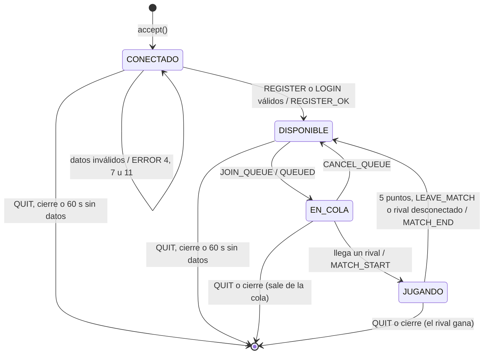
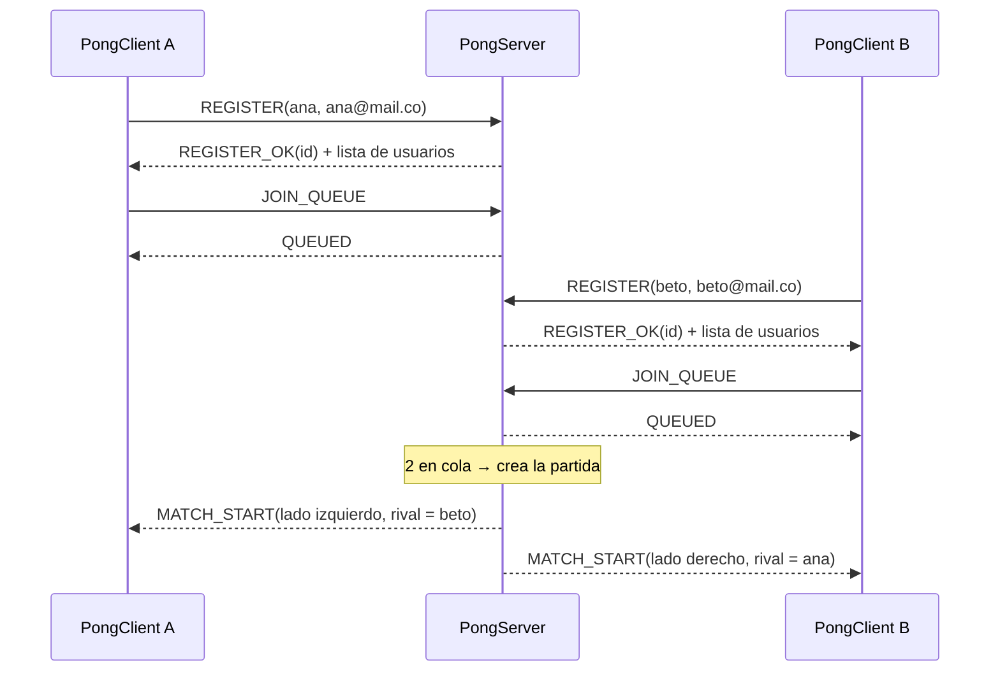
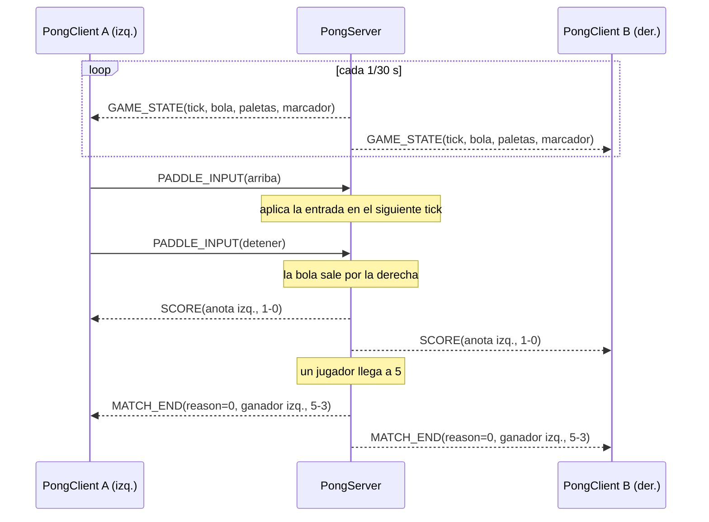
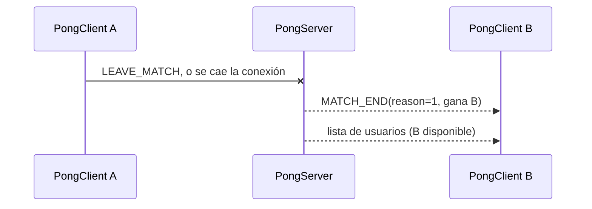
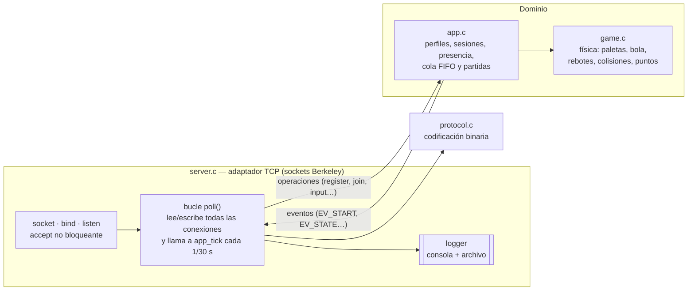

# MyAppGameProtocol — Pong Game Protocol (PGP) versión 2

Especificación del protocolo de capa de aplicación entre **PongClient** (`client/`) y **PongServer** (`src/`).

## 1. Especificación del servicio

PGP permite que varios clientes:

1. **Se registren** en el servidor creando su perfil con *nickname* y *correo electrónico* (`REGISTER`). Si el perfil ya existe y nadie lo está usando, el mismo mensaje lo retoma.
2. Opcionalmente, **inicien sesión con una cuenta reservada** por el administrador (`LOGIN` con nick, correo y token). Así un nick queda protegido para un jugador concreto.
3. **Consulten quién está conectado** y en qué estado (disponible, esperando o jugando).
4. **Pidan partida**: entran a una cola FIFO y el servidor los empareja de a dos.
5. **Jueguen**: el cliente solo envía la dirección de su paleta. El servidor es la **autoridad**: simula la física, valida las entradas, calcula los puntos y envía el estado a ambos jugadores 30 veces por segundo.
6. **Terminen la partida** al llegar a 5 puntos, por abandono o por desconexión del rival.
7. **Midan la latencia** (`PING`/`PONG`) y **cierren la sesión** de forma ordenada (`QUIT`).

Ningún mensaje viaja directamente entre clientes: todo pasa por el servidor.

## 2. Transporte: TCP (`SOCK_STREAM`)

| Necesidad | Con TCP | Con UDP |
|---|---|---|
| Registro, cola, inicio y fin de partida, errores | Llegan siempre y en orden | Habría que programar confirmaciones y retransmisiones |
| `PADDLE_INPUT` (solo se envía cuando cambia la dirección) | Si se perdiera un `STOP`, la paleta seguiría moviéndose; TCP lo evita | Pérdida = paleta "pegada" |
| `GAME_STATE` (30 Hz) | Una pérdida retrasa los siguientes (*head-of-line blocking*) | Ideal: el siguiente estado reemplaza al perdido |
| Complejidad | Una conexión por cliente | Dos canales o confiabilidad propia |

**Decisión:** se usa **solo TCP**. El tráfico es pequeño (22 bytes por `GAME_STATE`, unos 660 B/s por jugador) y se activa `TCP_NODELAY` en ambos extremos para que cada mensaje salga de inmediato, sin esperar al algoritmo de Nagle.

**Cuándo convendría UDP:** en un juego más rápido o con pérdidas frecuentes, `GAME_STATE` podría ir por UDP (cada estado lleva `tick`, así que el cliente descartaría los atrasados) y todo lo demás seguiría por TCP. La cabecera ya lo permitiría.

## 3. Formato de los mensajes (codificación binaria)

Cada mensaje tiene una **cabecera fija de 8 bytes** y un **payload** de 0 a 512 bytes.

```
  0        1        2        3        4        5        6        7
 +--------+--------+--------+--------+--------+--------+--------+--------+
 | MAGIC  |VERSION |  TYPE  | FLAGS  |       SEQ       |     LENGTH      |
 +--------+--------+--------+--------+--------+--------+--------+--------+
 |                 PAYLOAD (LENGTH bytes)                    ...
 +--------+--------+-----
```

| Campo | Tamaño | Valor |
|---|---|---|
| MAGIC | 1 B | `0x50` (`'P'`): detecta tráfico que no es PGP |
| VERSION | 1 B | `0x02` |
| TYPE | 1 B | Tipo de mensaje. Bit alto 0 = cliente→servidor, 1 = servidor→cliente |
| FLAGS | 1 B | Reservado, siempre 0 |
| SEQ | 2 B | Contador de mensajes de cada emisor (módulo 65536). Sirve para trazar en el log |
| LENGTH | 2 B | Longitud del payload (máximo 512) |

**Reglas de codificación**

- Enteros multibyte en **orden de red (big-endian)**.
- Cadenas como `[longitud u8][bytes ASCII]`, sin `'\0'`.
- Nunca se envían `struct` de C tal cual: se serializan campo a campo en `src/protocol.c` y `client/wire.py`.
- **Delimitación:** TCP es un flujo de bytes. El receptor acumula hasta tener 8 bytes de cabecera y luego `LENGTH` bytes de payload; una lectura puede traer varios mensajes o solo un pedazo de uno.

**Ejemplo:** `REGISTER` de `ana` / `ana@mail.co`

```
50 02 01 00 00 00 00 10   03 61 6E 61   0B 61 6E 61 40 6D 61 69 6C 2E 63 6F
'P' v2 REG fl seq=0 len=16  3  a  n  a   11 a  n  a  @  m  a  i  l  .  c  o
```

## 4. Vocabulario

### 4.1 Cliente → Servidor

| TYPE | Mensaje | Payload |
|---|---|---|
| `0x01` | REGISTER | nick (1–32, `A-Z a-z 0-9 _ - .`) · correo (3–64, con una `@`) |
| `0x02` | JOIN_QUEUE | — |
| `0x03` | PADDLE_INPUT | `dir u8`: 0 = detener, 1 = arriba, 2 = abajo |
| `0x04` | LEAVE_MATCH | — |
| `0x05` | PING | `timestamp u32` |
| `0x06` | QUIT | — |
| `0x07` | LOGIN | nick · correo · token (1–64), para cuentas preaprovisionadas |
| `0x08` | LIST_USERS | — |
| `0x09` | CANCEL_QUEUE | — |

### 4.2 Servidor → Cliente

| TYPE | Mensaje | Payload |
|---|---|---|
| `0x81` | REGISTER_OK | `player_id u32`: perfil creado/retomado o login aceptado |
| `0x82` | QUEUED | — |
| `0x83` | MATCH_START | `match_id u32` · `side u8` · `win_score u8` · `field_w u16` · `field_h u16` · `paddle_w u16` · `paddle_h u16` · `ball_size u16` · nick del rival |
| `0x84` | GAME_STATE | `tick u32` · `ball_x u16` · `ball_y u16` · `paddle_l u16` · `paddle_r u16` · `score_l u8` · `score_r u8` (14 B) |
| `0x85` | SCORE | `scorer u8` · `score_l u8` · `score_r u8` |
| `0x86` | MATCH_END | `reason u8` · `winner u8` · `score_l u8` · `score_r u8` |
| `0x87` | PONG | `timestamp u32` (eco del PING) |
| `0x88` | USER | `player_id u32` · `estado u8` · nick |
| `0x89` | USERS_BEGIN | — |
| `0x8A` | USERS_END | — |
| `0xFF` | ERROR | `code u8` · descripción (máx. 128) |

**Valores:** lado 0 = izquierda, 1 = derecha; `winner` 255 = ninguno. `reason`: 0 = llegó a 5 puntos, 1 = abandono o desconexión, 2 = servidor detenido. Estado de presencia: 1 = disponible, 2 = en cola, 3 = jugando.

**Coordenadas:** origen arriba a la izquierda; campo de 800×600; paletas de 10×100 con centros en x = 20 y x = 780; bola de 10 px. Bola y paletas se envían por su **centro**.

**Presencia:** `USERS_BEGIN`, cero o más `USER` y `USERS_END` forman una lista completa que reemplaza a la anterior. Se envía a todos al registrarse alguien, al desconectarse, al entrar o salir de la cola y al empezar o terminar una partida. Nunca se difunden correos ni tokens.

## 5. Errores

| Código | Significado | ¿Cierra la conexión? |
|---|---|---|
| 2 | Tipo de mensaje desconocido | No |
| 3 | Payload mal formado | No |
| 4 | Nick o correo con formato inválido (REGISTER) | No |
| 5 | Operación que exige registrarse primero | No |
| 6 | La sesión ya está registrada/autenticada | No |
| 7 | Nick ocupado: conectado en otra sesión, registrado con otro correo o reservado con token | No |
| 8 | Mensaje no válido en el estado actual | No |
| 9 | Sin capacidad (partidas o perfiles) | No |
| 11 | LOGIN con credenciales incorrectas | No |

Cabecera inválida (MAGIC, VERSION, FLAGS ≠ 0 o LENGTH > 512) y servidor sin cupo de conexiones cierran la conexión sin respuesta, porque el flujo TCP no se puede resincronizar. Tras 10 `LOGIN` fallidos en una conexión, el servidor la cierra.

## 6. Reglas de procedimiento

### 6.1 Máquina de estados de la sesión (vista del servidor)



### 6.2 Mensajes permitidos por estado

| Mensaje | CONECTADO | DISPONIBLE | EN_COLA | JUGANDO |
|---|---|---|---|---|
| REGISTER / LOGIN | ✔ | ERROR 6 | ERROR 6 | ERROR 6 |
| LIST_USERS | ERROR 5 | ✔ | ✔ | ✔ |
| JOIN_QUEUE | ERROR 5 | ✔ | ERROR 8 | ERROR 8 |
| CANCEL_QUEUE | ERROR 8 | ERROR 8 | ✔ | ERROR 8 |
| PADDLE_INPUT | se descarta | se descarta | se descarta | ✔ |
| LEAVE_MATCH | ERROR 8 | ERROR 8 | ERROR 8 | ✔ |
| PING / QUIT | ✔ | ✔ | ✔ | ✔ |

### 6.3 Reglas

1. El cliente abre una conexión TCP. Lo primero que envía es `REGISTER` (o `LOGIN` si tiene cuenta reservada).
2. **Registro:** si el nick no existe, se crea el perfil. Si existe con el mismo correo y no está conectado, se retoma. Si está conectado, tiene otro correo o está reservado con token, se responde `ERROR 7`.
3. `QUEUED` siempre llega antes que `MATCH_START`. El primero que entró a la cola se empareja con el siguiente (FIFO).
4. Tras `MATCH_START` hay una pausa de 1 segundo; luego el servidor envía `GAME_STATE` cada 1/30 s a ambos jugadores.
5. El cliente envía `PADDLE_INPUT` solo cuando cambia la dirección, y `STOP` al soltar la tecla o perder el foco. El servidor solo acepta 0, 1 o 2.
6. El cliente **no simula** nada: dibuja lo que dice `GAME_STATE`. Cada punto genera además un `SCORE`.
7. La partida termina con `MATCH_END` cuando alguien llega a 5 puntos, envía `LEAVE_MATCH` o se desconecta. En los dos últimos casos gana el rival. Ambos vuelven a DISPONIBLE.
8. El cliente envía `PING` cada 10 s. Si el servidor no recibe nada en 60 s, o si un cliente no lee sus datos durante 5 s, lo desconecta. La cola de salida está limitada a 64 KiB por conexión, para que un cliente lento no frene a los demás.
9. Con `SIGINT`/`SIGTERM` el servidor intenta enviar `MATCH_END` con `reason = 2` a las partidas activas y cierra los sockets.

## 7. Diagramas de secuencia

### 7.1 Registro y emparejamiento



### 7.2 Juego y fin por puntos



### 7.3 Abandono o desconexión



## 8. Arquitectura del servidor



**Concurrencia.** El servidor atiende a todos los clientes y todas las partidas a la vez con **multiplexación de E/S** (`poll()` sobre sockets no bloqueantes), en un solo hilo. El enunciado permite hilos pero no los exige. Se eligió `poll()` porque:

- no hay estado compartido entre hilos, así que no hacen falta mutex ni hay condiciones de carrera (por ejemplo, entre el fin de una partida y la desconexión de un jugador);
- un cliente lento no bloquea a nadie, porque cada conexión tiene su propio búfer de salida;
- el bucle de juego a 30 Hz vive en el mismo ciclo que la red, así que la entrada de un jugador y el siguiente `GAME_STATE` siempre se procesan en orden.

**Desacoplamiento.** `game.c` no sabe nada de red; `app.c` recibe operaciones y emite eventos de dominio; `protocol.c` solo serializa; `server.c` traduce entre paquetes y eventos. En el cliente, `wire.py` (codificación y socket) está separado de `pong.py` (interfaz).

## 9. Logger

Cada evento se imprime en consola y se agrega al archivo indicado en `./server <PORT> <LogFile>`:

```
2026-10-25 14:13:38 READY TCP port=8080 log=server.log cuentas_con_token=0 (sin users.conf: solo registro abierto)
2026-10-25 14:13:38 CONNECT client=0 from=127.0.0.1:55556
2026-10-25 14:13:38 RECV client=0 type=0x01 REGISTER seq=0 len=16
2026-10-25 14:13:38 REGISTER client=0 nick=ana email=ana@mail.co
2026-10-25 14:13:38 AUTH_OK client=0 nick=ana player_id=1
2026-10-25 14:13:38 SEND client=0 type=0x81 REGISTER_OK seq=0 len=4
2026-10-25 14:13:38 RECV client=0 type=0x02 JOIN_QUEUE seq=1 len=0
2026-10-25 14:13:38 SEND client=0 type=0x82 QUEUED seq=4 len=0
```

Se registran: conexiones y desconexiones (con IP y puerto), **todas las peticiones recibidas** (`RECV`), **todas las respuestas enviadas** (`SEND`, incluidos los `GAME_STATE`), registros e inicios de sesión, entradas de paleta (`INPUT`), inicio de partida, puntos, fin de partida y errores. Los tokens nunca se escriben en el log.
